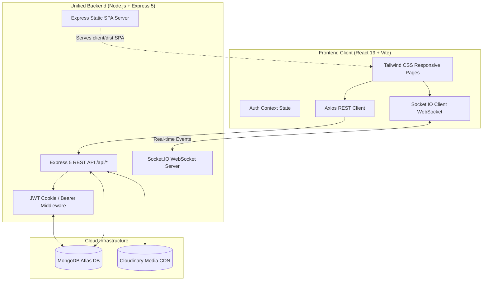
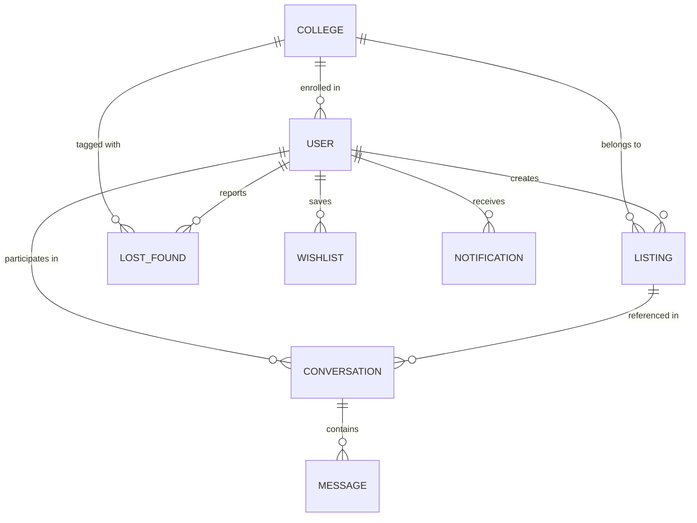

# 🎓 StudentMarket — Campus Marketplace & Essentials Hub

[](https://student-marketplace-2.onrender.com/)
[](https://react.dev/)
[](https://expressjs.com/)
[](https://www.mongodb.com/)
[](https://socket.io/)
[](https://tailwindcss.com/)
[](https://cloudinary.com/)

> **A modern, full-stack, hyper-local peer-to-peer campus ecosystem designed exclusively for college students to buy, sell, rent, claim freecycle items, recover lost belongings, and chat in real time.**

🔗 **Live Application URL:** [https://student-marketplace-2.onrender.com/](https://student-marketplace-2.onrender.com/)

---

## 📌 Table of Contents

- [Overview & Problem Statement](#-overview--problem-statement)
- [Key Features](#-key-features)
  - [1. Campus Marketplace (Buy, Sell, Rent, Free)](#1-campus-marketplace-buy-sell-rent-free)
  - [2. Integrated "Lost & Found" & Zero-Rupee Freecycle Hub](#2-integrated-lost--found--zero-rupee-freecycle-hub)
  - [3. Real-Time Chat & Direct Messaging (Socket.IO)](#3-real-time-chat--direct-messaging-socketio)
  - [4. Campus Identity & Multi-Tenancy](#4-campus-identity--multi-tenancy)
  - [5. Wishlist & Notification Center](#5-wishlist--notification-center)
  - [6. Student Analytics Dashboard](#6-student-analytics-dashboard)
- [Architecture & Tech Stack](#-architecture--tech-stack)
- [Database Schema & Models](#-database-schema--models)
- [API Endpoints Reference](#-api-endpoints-reference)
- [Local Development & Setup Guide](#-local-development--setup-guide)
- [Environment Variables Checklist](#-environment-variables-checklist)
- [Production Deployment](#-production-deployment)
- [Project Structure](#-project-structure)
- [Contributing & License](#-contributing--license)

---

## 💡 Overview & Problem Statement

University and college students face persistent logistical hurdles:
1. **High Costs & Short-Term Needs:** Textbooks, scientific calculators, lab drafters, bicycles, and lab coats are needed for only one semester or term, yet purchasing them brand new is expensive.
2. **Untrusted Generic Marketplaces:** Traditional platforms like OLX or Facebook Marketplace involve strangers, expensive parcel delivery fees, delivery delays, and online scams.
3. **No Campus Lost-and-Found System:** Belongings lost across campus libraries, canteens, and lecture halls rely on chaotic WhatsApp groups with high rates of theft or misplacement.
4. **Graduation Waste:** Graduating seniors often throw away or leave behind functional mattresses, study materials, cycles, and kitchenware because there is no organized channel to donate them to juniors.

**StudentMarket** provides an all-in-one, college-isolated platform where students meet safely at known campus spots, trade at fair peer prices or ₹0, track short-term rentals, recover lost items via anti-theft questions, and chat without exposing personal contact details.

---

## ✨ Key Features

### 1. Campus Marketplace (Buy, Sell, Rent, Free)
- **Multi-Transaction Support:**
  - **Sell:** Peer-to-peer sales with custom student pricing.
  - **Rent:** Short-term rentals with deposit tracking, rental duration (per day/week/month), and return management.
  - **Donate / Free:** ₹0 giveaways directly for campus juniors.
- **Rich Media Uploads:** Multi-image uploads processed via Multer and uploaded to Cloudinary CDN with automatic data-URI fallback.
- **Instant Search & Multi-Criteria Filtering:** Full-text keyword search across titles and descriptions powered by MongoDB text indexes; filter by college campus, product category, transaction type, and price range.
- **Product Lifecycle:** Full seller controls (`Active` → `Reserved` → `Sold/Completed`, editing, and deletion).

### 2. Integrated "Lost & Found" & Zero-Rupee Freecycle Hub
A dedicated campus community board:
- **Lost & Found Tracker:**
  - Report lost or found campus items (ID cards, earphones, keys, bags, notebooks) with date, location (e.g. *Library 2nd Floor, Room 304*), and photos.
  - **Anti-Theft Ownership Verification:** Finders can add a secret ownership question (e.g., *"What is the sticker on the back?"* or *"What color is the keychain?"*). Claimants must answer correctly to prevent fraudulent claims.
  - Status tracking: `Open` → `Claimed` → `Resolved`.
- **Zero-Rupee Freecycle Hub:**
  - Seniors can list textbooks, hostel furniture, stationery, drafters, and cycles at **₹0**.
  - Juniors can submit a claim request with a brief statement of purpose.

### 3. Real-Time Chat & Direct Messaging (Socket.IO)
- **Item-Linked Inquiries:** Start a 1-on-1 private chat directly from any product page with the item context pre-loaded.
- **WebSocket Synchronization:** Messages, read receipts, and unread counters update in real time without page refreshes.
- **Safety:** Enables full buyer-seller negotiation without sharing personal phone numbers or social media handles.

### 4. Campus Identity & Multi-Tenancy
- **College-Level Filtering:** Students register with their specific college or university.
- **Hyper-Local Trust:** See which college the seller belongs to; students can coordinate face-to-face exchanges at campus landmarks (hostel gate, canteen, library).

### 5. Wishlist & Notification Center
- **Wishlist:** 1-click heart toggle to save listings for later; instant feedback and dedicated management page.
- **In-App Notification Center:** Real-time bell dropdown alerting students when they receive messages, when their listings are claimed, or when an item's status changes.

### 6. Student Analytics Dashboard
- **Overview Metrics:** Total listings, active listings, reserved products, completed transactions, and unread chat inquiries.
- **Profile Center:** Avatar customization, contact details, bio, and student verification status.

---

## 🛠 Architecture & Tech Stack



| Component | Technology | Description |
|---|---|---|
| **Frontend Framework** | React 19 + Vite | Blazing fast client rendering with React 19 hooks and JSX |
| **Routing** | React Router DOM v7 | Client-side declarative routing and protected auth routes |
| **Styling** | Tailwind CSS v3 | Modern mobile-first styling with custom blue/indigo aesthetic |
| **Backend Framework** | Express v5.3 + Node.js | Robust REST API with Express 5 wildcard parameter handling |
| **Real-Time Engine** | Socket.IO v4 | Low-latency bi-directional WebSocket communication |
| **Database** | MongoDB Atlas + Mongoose 9 | Scalable cloud NoSQL database with optimized compound indexes |
| **Authentication** | JWT + Bcrypt | Secure token-based auth with salted password hashing |
| **File Storage** | Cloudinary CDN + Multer | Cloud storage, image transformations, and responsive media delivery |
| **Hosting & CI/CD** | Render | Unified production web service hosting frontend + backend + WebSockets |

---

## 🗄 Database Schema & Models



1. **`User`:** Full name, email, password hash, phone, college reference, profile picture, bio, role (`student`/`admin`), status.
2. **`College`:** Name, location, city, state, code.
3. **`Listing`:** Title, description, price, listingType (`sell`, `rent`, `free`), category, deposit details, rental duration, images array, status (`active`, `reserved`, `sold`), college, seller.
4. **`LostFound`:** Title, type (`lost`, `found`, `freecycle`), category, location, date, photos, secret verification question, status (`open`, `claimed`, `resolved`), reporter, claimant.
5. **`Conversation`:** Array of 2 participants, referenced listing, last message snippet, unread counter.
6. **`Message`:** Conversation reference, sender ID, text content, read receipt flag, timestamps.
7. **`Wishlist`:** User reference, listing reference with compound unique index to prevent duplicate bookmarks.
8. **`Notification`:** Recipient user, notification type, title, message text, link URL, read status.

---

## 📡 API Endpoints Reference

### Authentication (`/api/auth`)
| Method | Endpoint | Description | Auth Required |
|---|---|---|:---:|
| `POST` | `/api/auth/register` | Register new student profile | No |
| `POST` | `/api/auth/login` | Authenticate student and issue JWT token | No |
| `POST` | `/api/auth/logout` | Clear session cookie | Yes |
| `GET` | `/api/auth/me` | Fetch currently logged-in student profile | Yes |

### Colleges (`/api/colleges`)
| Method | Endpoint | Description | Auth Required |
|---|---|---|:---:|
| `GET` | `/api/colleges` | List all colleges for registration dropdown | No |
| `GET` | `/api/colleges/:id` | Fetch college details | No |

### Marketplace Listings (`/api/listings`)
| Method | Endpoint | Description | Auth Required |
|---|---|---|:---:|
| `GET` | `/api/listings` | Search & filter active listings (query params) | No |
| `GET` | `/api/listings/:id` | Get single listing full details with seller info | No |
| `POST` | `/api/listings` | Create listing (multipart/form-data for images) | Yes |
| `PUT` | `/api/listings/:id` | Update listing details or status | Yes (Owner) |
| `DELETE` | `/api/listings/:id` | Delete listing and remove media | Yes (Owner) |
| `GET` | `/api/listings/my` | Get all listings created by current user | Yes |

### Lost & Found / Freecycle (`/api/lost-found`)
| Method | Endpoint | Description | Auth Required |
|---|---|---|:---:|
| `GET` | `/api/lost-found` | List lost/found/freecycle items with filters | No |
| `POST` | `/api/lost-found` | Report a lost, found, or freecycle item | Yes |
| `GET` | `/api/lost-found/:id` | Get details and claim prompt | No |
| `POST` | `/api/lost-found/:id/claim` | Submit claim answer / freecycle request | Yes |
| `PATCH` | `/api/lost-found/:id/status` | Update item status (`open`/`claimed`/`resolved`) | Yes (Reporter) |

### Real-Time Chat (`/api/conversations` & `/api/messages`)
| Method | Endpoint | Description | Auth Required |
|---|---|---|:---:|
| `GET` | `/api/conversations` | Get user's conversation threads | Yes |
| `POST` | `/api/conversations` | Get or create conversation for a listing | Yes |
| `GET` | `/api/messages/:conversationId` | Fetch message history for a conversation | Yes |
| `POST` | `/api/messages` | Send message (also triggers Socket.IO event) | Yes |

### Wishlist (`/api/wishlist`)
| Method | Endpoint | Description | Auth Required |
|---|---|---|:---:|
| `GET` | `/api/wishlist` | Fetch all saved listings for user | Yes |
| `POST` | `/api/wishlist/toggle` | Toggle listing in/out of wishlist | Yes |
| `GET` | `/api/wishlist/check/:listingId` | Check if a specific listing is saved | Yes |

---

## 💻 Local Development & Setup Guide

### Prerequisites
- [Node.js](https://nodejs.org/) (version `18.x` or higher)
- [npm](https://www.npmjs.com/) or [pnpm](https://pnpm.io/)
- A free [MongoDB Atlas](https://www.mongodb.com/) cluster URI
- A free [Cloudinary](https://cloudinary.com/) account (Cloud Name, API Key, API Secret)

### Step 1: Clone the Repository
```bash
git clone https://github.com/Deepakmaurya5792/STUDENT_MARKETPLACE.git
cd STUDENT_MARKETPLACE
```

### Step 2: Install All Dependencies
```bash
# Installs root, client, and server dependencies in one command
npm run postinstall
```

### Step 3: Setup Environment Variables
Create a `.env` file in the `server/` directory (or use root `.env`):
```env
PORT=5000
NODE_ENV=development
CLIENT_URL=http://localhost:5173

# MongoDB Atlas
MONGODB_URI=mongodb+srv://<username>:<password>@cluster0.xxxxx.mongodb.net/Student_Market_Place?retryWrites=true&w=majority

# JWT Authentication
JWT_SECRET=your_super_secret_jwt_key_here_min_32_chars

# Cloudinary CDN
CLOUDINARY_CLOUD_NAME=your_cloud_name
CLOUDINARY_API_KEY=your_api_key
CLOUDINARY_API_SECRET=your_api_secret
```

### Step 4: Seed Initial Colleges & Sample Data
```bash
npm run seed:colleges
npm run seed:lostfound
```

### Step 5: Start Development Servers
Open two terminal windows:

**Terminal 1 (Backend Server on Port 5000):**
```bash
npm run dev:server
```

**Terminal 2 (Frontend Client on Port 5173):**
```bash
npm run dev:client
```

Open **[http://localhost:5173](http://localhost:5173)** in your browser!

---

## ⚙️ Environment Variables Checklist

| Variable Name | Environment | Description | Example |
|---|:---:|---|---|
| `PORT` | Server | Port for Express and Socket.IO | `5000` or `10000` |
| `NODE_ENV` | Server | Execution mode (`development`/`production`) | `production` |
| `MONGODB_URI` | Server | MongoDB Atlas connection string | `mongodb+srv://...` |
| `JWT_SECRET` | Server | Secret for signing and verifying tokens | `your_secret_key_32_chars` |
| `CLIENT_URL` | Server | Permitted frontend origins for CORS | `https://student-marketplace-2.onrender.com` |
| `CLOUDINARY_CLOUD_NAME` | Server | Cloudinary cloud identifier | `dxyz123` |
| `CLOUDINARY_API_KEY` | Server | Cloudinary API Key | `182233185532456` |
| `CLOUDINARY_API_SECRET` | Server | Cloudinary API Secret | `xxxxxxxxxxxxxxxx` |
| `VITE_API_URL` | Client *(Optional)* | Backend API base URL (for split deploy) | `https://api.my-domain.com/api` |
| `VITE_SOCKET_URL` | Client *(Optional)* | Backend WebSocket host (for split deploy) | `https://api.my-domain.com` |

---

## 🚀 Production Deployment

### All-in-One Deployment on Render (Active)
This project is pre-configured with [render.yaml](render.yaml) and production static serving in [server/index.js](server/index.js):
- **Build Command:** `npm install && npm run build`
- **Start Command:** `npm start`
- **Root Directory:** *(leave blank / root)*

### Containerized Deployment (Docker)
Run the entire production stack inside Docker:
```bash
docker compose up --build -d
```
Access the application at `http://localhost:5000`.

---

## 📁 Project Structure

```text
STUDENT_MARKETPLACE/
├── client/                     # Frontend (React 19 + Vite)
│   ├── public/                 # Static assets (3D isometric hero illustration, logo, favicon)
│   ├── src/
│   │   ├── components/         # Reusable UI widgets (CollegeSelect, NotificationBell, WishlistButton)
│   │   ├── context/            # React AuthContext
│   │   ├── Pages/              # Application pages (Listings, CampusHub, Dashboard, Chat, etc.)
│   │   ├── services/           # Axios API services & Socket.IO client instances
│   │   ├── App.jsx             # Top-level router and responsive navigation bar
│   │   └── main.jsx            # React root mount
│   ├── package.json
│   └── vite.config.js
├── server/                     # Backend (Node.js + Express 5 + Socket.IO)
│   ├── config/                 # Database connection (Mongoose)
│   ├── controllers/            # Controller business logic
│   ├── middleware/             # JWT auth middleware, Multer image upload
│   ├── models/                 # Mongoose schemas (User, College, Listing, LostFound, Message, etc.)
│   ├── routes/                 # Express REST route endpoints
│   ├── utils/                  # Cloudinary upload helpers with base64 fallback
│   ├── seedColleges.js         # College database seeder
│   ├── seedLostFound.js        # Lost & Found seeder
│   ├── package.json
│   └── index.js                # Express & Socket.IO server entrypoint
├── Dockerfile                  # Multi-stage production container build
├── docker-compose.yml          # Container composition definition
├── render.yaml                 # Render Blueprint configuration
├── Procfile                    # Heroku / Railway process definition
├── DEPLOYMENT.md               # Step-by-step deployment guide
├── package.json                # Root package orchestrator
└── README.md                   # Project documentation
```

---

## 🤝 Contributing & License

Contributions, feature ideas, and pull requests are welcome!

1. Fork the repository
2. Create your feature branch (`git checkout -b feature/NewFeature`)
3. Commit your changes (`git commit -m 'Add NewFeature'`)
4. Push to the branch (`git push origin feature/NewFeature`)
5. Open a Pull Request

**Developed with ❤️ for College & Campus Communities.**
